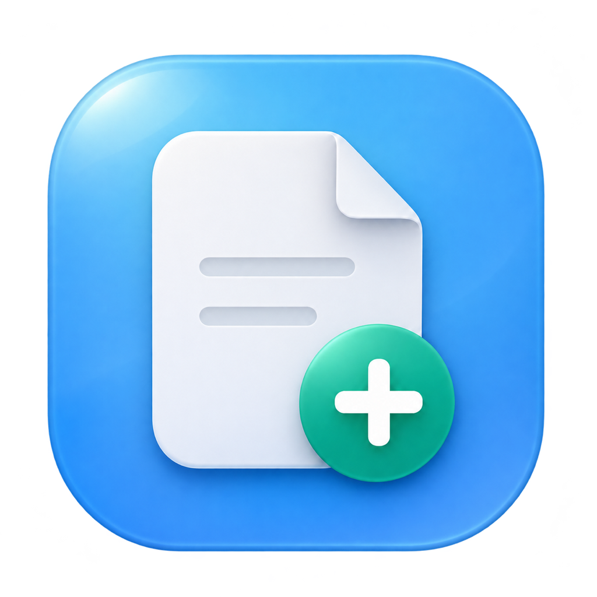

# 初页 · mac快速创建文件



**初页**是一个使用 Swift 编写的轻量 macOS Finder 扩展，在文件夹空白处的右键菜单中添加“新建文件”子菜单。

鼠标移到“新建文件”，点击 **TXT** 或 **Markdown** 即可直接创建，无需输入文件名或再次确认。

## 功能

- 创建空白 `.txt`、`.md` 文件，默认名称为“未命名.txt”“未命名.md”。
- 重名自动编号，例如“未命名 1.md”，不覆盖已有文件、文件夹或符号链接。
- 创建后在 Finder 中自动选中，可按回车重命名。
- 主程序没有 Dock 图标或菜单栏状态图标，完成后退出。
- 不添加登录启动项、不扫描文件、不读取文档内容、不联网。

## 直接下载使用（无需编译）

**[下载初页安装包（DMG）](https://github.com/quyanxin0629-del/mac-quick-create-file/releases/latest/download/Chuye-macOS-universal.dmg)** · [ZIP 备用下载](https://github.com/quyanxin0629-del/mac-quick-create-file/releases/latest/download/Chuye-macOS-universal.zip) · [全部版本](https://github.com/quyanxin0629-del/mac-quick-create-file/releases)

适用于 macOS 14 或更新版本，Universal 安装包包含 Apple Silicon 和 Intel 两种架构。下载安装包不需要 Git、Swift 或 Xcode。

1. 下载并打开 `.dmg` 文件。
2. 将 **初页.app** 拖到旁边的 **Applications（应用程序）** 文件夹。
3. 从“应用程序”中打开“初页”，按提示在系统设置里启用 **“初页”Finder 扩展**。
4. 打开本地文件夹，在空白处右键，将鼠标移到“新建文件”，点击 TXT 或 Markdown 即可创建。

首次在“文稿”“桌面”“下载”等受保护文件夹中使用时，macOS 可能询问对应文件夹的访问权限，允许后即可正常使用。

ZIP 版解压后，将“初页.app”移入 `/Applications`，再打开并启用扩展。

此版本使用临时签名，尚未经过 Apple 公证。首次打开如果提示无法验证开发者，可在“系统设置 → 隐私与安全”中找到“初页”，选择“仍要打开”。如果系统没有提供允许选项，可使用下方的源码构建方式。

## 从源码构建与安装

### 环境要求

- macOS 14 或更新版本。
- Apple Command Line Tools，包含 Swift 编译器。
- 无第三方依赖，无需安装完整 Xcode。

在 Apple Silicon、macOS 27.0.1、Swift 6.4 环境构建并使用；其他系统版本和架构需自行确认兼容性。

```sh
git clone https://github.com/quyanxin0629-del/mac-quick-create-file.git
cd mac-quick-create-file
./Scripts/build.sh
./Scripts/install.sh
```

默认构建当前机器架构，产物为 `build/初页.app`，安装到 `/Applications/初页.app`，与其他 Mac 应用放在一起。

安装脚本会迁移旧版个人应用目录中的安装，并注册、启用 Finder 扩展。如果 `/Applications` 不可写，可通过 Finder 手动复制 App 并完成系统授权。如果菜单没有显示，打开“初页”，按提示在系统设置里启用同名扩展，再重新打开本地文件夹。

生成与 Releases 一致的 Universal 安装包：

```sh
./Scripts/build.sh --universal
./Scripts/package.sh
```

安装包和 SHA-256 校验文件保存在 `build/release/`。

## 使用

1. 在本地文件夹的空白处右键。
2. 将鼠标放到“新建文件”上。
3. 点击“TXT 文本文件 (.txt)”或“Markdown (.md)”，立即创建。

## 配置默认名称

设置不带后缀的基础名称：

```sh
defaults write com.cyrix.finder-new-file DefaultBaseName -string '笔记'
```

分别创建“笔记.txt”“笔记.md”。恢复默认：

```sh
defaults delete com.cyrix.finder-new-file DefaultBaseName
```

## 扩展文件类型

在 `Sources/FileCreationCore/NewFileType.swift` 中增加类型、菜单名称、后缀和唯一的菜单 tag，再重新构建安装。

当前创建的是空白文件。Word、Excel、PDF 等格式需要有效模板，不能通过添加后缀直接支持。

## 项目结构

```text
Sources/
  App/AppMain.swift                    # 创建入口、错误提示和结果选中
  FinderExtension/FinderExtension.swift # Finder 原生右键子菜单
  FileCreationCore/
    NewFileType.swift                  # 类型和菜单定义
    FileCreator.swift                  # 原子创建与重名保护
    CreateRequest.swift                # 目录、类型和请求凭据校验
Resources/                             # App/扩展配置与沙盒权限
  AppIcon.png                          # 初页图标原稿
Scripts/                               # 构建、安装、打包和卸载
```

扩展使用 App Sandbox，只处理 Finder 菜单上下文并唤起承载程序。承载程序使用当前用户权限创建文件，受保护目录可能需要 macOS 文件夹访问授权。

请求凭据在每次构建时随机生成，存放在生成的 App 中，不包含在源码仓库中。

## 卸载

直接下载用户：先在系统设置中停用“初页”扩展，再将 `/Applications/初页.app` 移到废纸篓。

从源码安装的用户也可以运行：

```sh
./Scripts/uninstall.sh
```

停用扩展并将 App 移到项目内的备份目录。源码、偏好设置和已经创建的文件保留。

## 图标

图标源文件为 `Resources/AppIcon.png`，构建时通过 macOS 自带的 `sips`、`iconutil` 导出多尺寸 `.icns` 并同时用于主程序和扩展。

图标使用内置图像生成工具设计。提示词概述：macOS 风格蓝色玻璃圆角底、白色折角文稿、青绿色加号，正视构图，柔和光影，无文字。

## 已知限制

- “最近使用”、搜索结果等虚拟位置不能作为创建目标。
- iCloud、Google Drive 等 File Provider 位置可能不显示 Finder Sync 菜单。
- 外置磁盘和网络共享目录未单独确认兼容性。
- Finder Sync 主要面向同步工具；Mac App Store 分发需要另行评估扩展使用场景及审核要求。

## 许可证

[MIT](LICENSE)

## 相关文档

- [Apple Finder Sync](https://developer.apple.com/library/archive/documentation/General/Conceptual/ExtensibilityPG/Finder.html)
- [Finder 空白处右键菜单接口](https://developer.apple.com/documentation/findersync/fimenukind/contextualmenuforcontainer)
